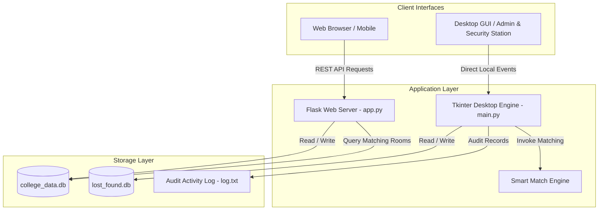
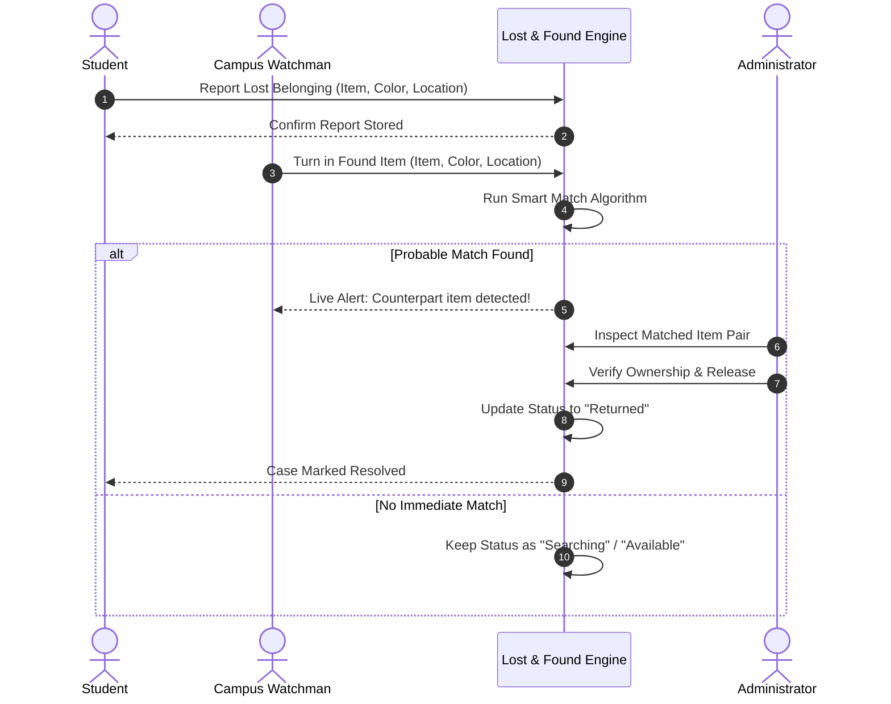

# 🎓 SBMP Lost & Found Management System

[](https://www.python.org/)
[](https://flask.palletsprojects.com/)
[](https://docs.python.org/3/library/tkinter.html)
[](https://www.sqlite.org/)
[](#testing)

An integrated campus asset recovery platform featuring an administrative Desktop Application (Tkinter) and a responsive Web Portal (Flask REST API) powered by intelligent item-matching algorithms.

**Lead Developer:** Aryan Yadav  
**Institution:** SBMP College  
**Repository:** [Coderaryanyadav/LostAndFound](https://github.com/Coderaryanyadav/LostAndFound)

---

## 🏗️ System Architecture



---

## 🔄 Match Resolution Workflow



---

## 🚀 Quick Setup & Execution

### Prerequisites

- Python 3.8+
- SQLite3

### 1. Clone & Install Dependencies

```bash
git clone https://github.com/Coderaryanyadav/LostAndFound.git
cd LostAndFound
pip install -r requirements.txt
```

### 2. Run the Web Application

```bash
python app.py
```
Open your browser to: `http://127.0.0.1:5000`

### 3. Run the Desktop Application

```bash
python main.py
```

---

## 🔑 Default Credentials

- **Admin Account:** `admin` / `admin`
- **Student Accounts:** Self-register via the **"New Student? Register Here"** button on the desktop landing screen.

---

## ⚙️ Features

| Feature | Description | Platform |
| :--- | :--- | :--- |
| **Real-Time Dashboard** | Visual statistics on active reports and matched belongings | Web |
| **Student Self-Service** | Register, login, report personal lost items, and track status | Desktop |
| **Found Registry** | Dedicated intake workflow for campus security and watchmen | Both |
| **Smart Matching** | Keyword token analysis, color checking, and room proximity logic | Both |
| **CSV Data Export** | One-click offline backup generation | Web & Desktop |
| **Audit Trails** | Timestamped action logging saved to `log.txt` | Desktop |

---

## 🧪 Testing & Verification

```bash
# Run web route unit test suite
python -m unittest test_app.py

# Run desktop logic & matching algorithm test suite
python -m unittest test_main.py

# Run complete end-to-end API test suite (start app.py first)
python heavy_test.py
```

---

## 📜 Community & Governance

- [Contributing Guidelines](file:///Users/aryan/Desktop/PROJECTS/NOT%20TESTED/8%20-%20LostAndFoundCollege/CONTRIBUTING.md)
- [Code of Conduct](file:///Users/aryan/Desktop/PROJECTS/NOT%20TESTED/8%20-%20LostAndFoundCollege/CODE_OF_CONDUCT.md)
- [Security Policy](file:///Users/aryan/Desktop/PROJECTS/NOT%20TESTED/8%20-%20LostAndFoundCollege/SECURITY.md)
- [Project License](file:///Users/aryan/Desktop/PROJECTS/NOT%20TESTED/8%20-%20LostAndFoundCollege/LICENSE)
